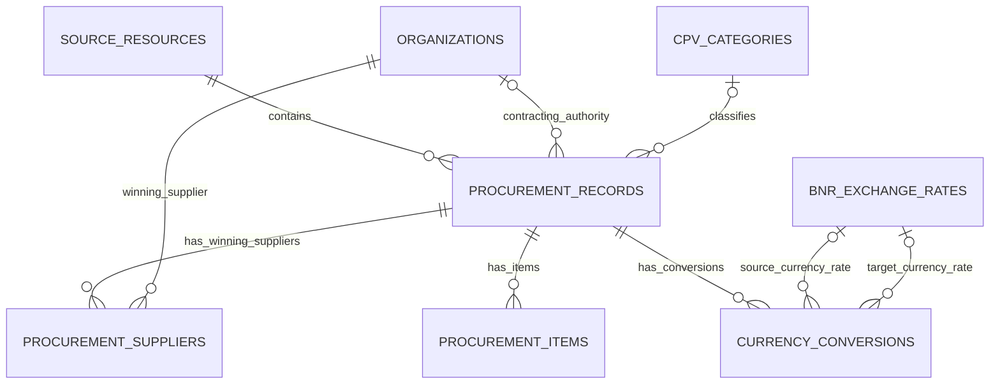

# Modelul relațional al datelor SEAP

Acesta este modelul țintă pentru unificarea exporturilor. Schema executabilă este în [`schema/data-model.sql`](../schema/data-model.sql); exemplul reproductibil este în [`data-sample-normalized.json`](data-sample-normalized.json). Importul celor 86 de resurse rămâne în Parquet cu antetele originale; transformarea integrală în entități urmează să fie implementată.

## Entități și sensul lor

| Entitate | Cheie | Rol |
|---|---|---|
| `organizations` | `organization_id` | Instituții, firme și alți furnizori, după evaluarea datelor personale. Numele și identificatorii organizației sunt păstrați o singură dată după identificarea verificată. |
| `procurement_records` | `record_id` | O înregistrare din sursă, cu tip, referință, date și valoare. Referă autoritatea prin `authority_id`. |
| `procurement_suppliers` | `record_id` + `supplier_id` | Legătura dintre înregistrare și fiecare furnizor câștigător identificat explicit. |
| `cpv_categories` | `cpv_code` + `scheme_version` | Categoria CPV. Versiunea este `unknown` până la verificare; eticheta originală rămâne pe înregistrare. |
| `procurement_items` | `item_id` | Produse/servicii individuale documentate, cu cantitate, unitate și eventual preț unitar. |
| `source_resources` | `source_resource_id` | Fișierul de origine, pachetul, URL-ul, licența și perioada exportului. |
| `bnr_exchange_rates` | `rate_id` | Curs oficial BNR pentru o valută și o dată, cu multiplicator și URL-ul arhivei. |
| `currency_conversions` | `conversion_id` | Conversie la data achiziției, cu valoare de origine, rezultat, baza datei și referințe către cursurile BNR. |

„Autoritate contractantă” înseamnă organizația care cumpără. Nu deducem că este și beneficiarul final al bunurilor. „Furnizor câștigător” este un rol într-o anumită înregistrare. Aceeași organizație poate cumpăra și furniza în înregistrări diferite; de aceea firmele și instituțiile folosesc aceeași entitate `organizations`. În interfață pot exista liste distincte de autorități și furnizori, obținute din relațiile lor cu achizițiile.

## Relații



O sursă poate avea multe înregistrări. O înregistrare are cel mult o autoritate identificată și cel mult un CPV principal, dar poate avea mai mulți furnizori sau mai multe poziții când sursa confirmă acest lucru. Lipsa unei legături înseamnă informație indisponibilă ori omisă, nu absența economică a unui furnizor.

## Câmpuri și maparea schemei anterioare

Cheile și restricțiile complete sunt în SQL. `PK` este identificatorul entității; `FK` este referința către altă entitate.

| Câmp anterior din CSV | Destinație relațională |
|---|---|
| `source_year` | `source_resources.source_year` |
| `source_period` | `source_resources.source_period` |
| `source_resource_id` | `source_resources.source_resource_id`, referit prin FK din `procurement_records` |
| `source_file` | `source_resources.source_file` |
| `contracting_authority` | `organizations.name`, referită prin `procurement_records.authority_id`; forma din sursă în `authority_name_source` |
| `authority_county` | `organizations.county`, doar după verificare |
| `record_type` | `procurement_records.record_type` |
| `procurement_reference` | `procurement_records.procurement_reference` |
| `published_at` | Textul actual în `published_at_source`; valoarea normalizată în `published_at` după validare |
| `contract_or_completion_date` | Textul actual în `contract_or_completion_date_source`; după verificarea sensului în `contract_date` sau `completion_date` |
| `title` | `procurement_records.title` |
| `cpv_code` | `procurement_records.cpv_code` + `cpv_scheme_version`, FK către `cpv_categories` |
| `cpv_label` | `procurement_records.cpv_label_source`; `canonical_label` în CPV numai după verificare |
| `contract_type` | `procurement_records.contract_type` |
| `procedure_type` | `procurement_records.procedure_type` |
| `number_of_offers` | `procurement_records.number_of_offers` |
| `supplier_name` | `organizations.name` + `procurement_suppliers.supplier_name_source`, numai după evaluarea datelor personale |
| `supplier_identifier` | `organizations.identifier`, numai după evaluarea datelor personale |
| `amount_source` | `procurement_records.amount_source`; valoare decimală validată în `amount_decimal` |
| `currency_source` | `procurement_records.currency_source` |
| `amount_eur` | `currency_conversions.converted_amount`, pentru `target_currency = 'EUR'`, cu metoda și cursul documentate |
| `quantity` | `procurement_items.quantity`, când poziția este documentată |
| `quantity_unit` | `procurement_items.quantity_unit` |

Câmpurile noi includ `organization_id`, `identity_status`, cheile legăturilor, prețul unitar și referința dovezii pentru o poziție. ID-urile interne nu sunt CUI-uri și nu înseamnă că identitatea a fost verificată. `source_sheet` și `source_row_number` sunt prevăzute pentru localizarea exactă în sursă; în exemplul derivat din CSV rămân necunoscute, deoarece CSV-ul anterior nu le include.

## Reguli de modelare

- Păstrăm o înregistrare per rând de sursă. Nu folosim numărul contractului ca identificator global și nu unificăm automat înregistrări din exporturi diferite.
- Rezolvarea identității organizațiilor trebuie făcută folosind identificatori verificați, țară și dovezi. Nu reunim organizații doar fiindcă numele lor seamănă. În exemplu există câte o organizație provizorie pentru fiecare autoritate din eșantion.
- O firmă câștigătoare se leagă prin `procurement_suppliers`. Nu împărțim automat denumirile de asocieri în firme individuale. Nu avem o entitate „persoană publică” populată fără surse și relații verificate.
- Categoria CPV nu reprezintă automat un produs individual. Nu creăm poziții și cantități dintr-un titlu sau din codul CPV. Nu atribuim valoarea totală ca preț unitar.
- Sumele originale se păstrează ca text. Valorile decimale validate sunt reprezentate prin text decimal exact în prototipul SQLite, evitând aproximarea în virgulă mobilă; un motor cu tip `DECIMAL` poate folosi acel tip. Datele normalizate vor folosi ISO 8601 după stabilirea sensului și preciziei sursei.
- Totalurile financiare se calculează din `procurement_records`, cu tratarea suprapunerilor și a duplicatelor. O unire cu mai mulți furnizori sau mai multe poziții poate multiplica rândurile; nu însumăm repetat valoarea contractului după o astfel de unire.
- Publicarea organizațiilor și a câmpurilor text respectă planul privind datele personale din propunere. În exemplul public nu există furnizori identificați, poziții, cursuri sau conversii monetare inventate.

## Conversia la cursul BNR din data achiziției

Sursa va fi exclusiv arhiva oficială BNR, descrisă în [documentația XML](https://www.bnr.ro/23988-cursurile-pietei-valutare-in-format-xml). Arhiva [2025](https://curs.bnr.ro/files/xml/years/nbrfxrates2025.xml), verificată în această etapă, conține moneda de origine RON, datele cotațiilor și ratele pentru EUR. Integrarea cursurilor în dataset nu este încă implementată.

Regula analitică a proiectului este `bnr_date_or_previous_v1`:

1. Pentru contracte publicate și subsecvente, `transaction_date` este data contractului verificată (`contract_date`). Pentru o achiziție directă folosim data atribuirii/acceptării (`award_date`) când aceasta este explicită în sursă; dacă exportul furnizează numai data finalizării și sensul ei este verificat, folosim `completion_date`. `date_basis` înregistrează alegerea. Nu folosim automat data anunțului, anul sau trimestrul exportului.
2. Selectăm cursul BNR publicat pentru data respectivă. Dacă în acea zi nu există cotație, folosim ultima cotație anterioară disponibilă în arhiva completă. Păstrăm separat `transaction_date` și `bnr_exchange_rates.rate_date`; nu folosim un curs ulterior. La început de an verificăm și arhiva anului precedent.
3. Dacă data achiziției, moneda sau valoarea nu pot fi validate, ori arhiva necesară lipsește, nu producem conversia și raportăm motivul. Lipsa unei arhive nu se tratează automat ca zi fără cotație.
4. În `bnr_exchange_rates` păstrăm `currency`, `rate_date`, `rate_value`, `unit_multiplier` și `source_url`. O rată este reutilizată de toate conversiile relevante. Cotația reprezintă `rate_value` RON pentru `unit_multiplier` unități de valută; la calcule o raportăm la o unitate. Pentru RON valoarea de referință este 1 și nu se creează o cotație artificială.
5. În `currency_conversions` păstrăm data achiziției, câmpul din care vine, suma și moneda de origine, moneda țintă, rezultatul și FK-urile către cursurile folosite. La RON → EUR folosim numai `target_rate_id`; la alte valute avem și `base_rate_id`. Monedele și datele ratelor trebuie verificate la transformare, pe lângă validarea FK-urilor.
6. Formula generală este `valoare_tinta = valoare_origine × curs_RON_pe_unitate_origine / curs_RON_pe_unitate_tinta`. Pentru RON → EUR: `valoare_EUR = valoare_RON / curs_EUR`. Calculăm cu `Decimal`, cu precizia cursului oficial; rotunjirea de afișare nu modifică valoarea-sursă.

Aceasta este o regulă de comparabilitate a datasetului, nu o afirmație despre cursul efectiv folosit la plata unui contract. Când datele financiare aparțin altui eveniment decât încheierea achiziției, trebuie documentat înainte de conversie. Pentru modele care folosesc numai informații disponibile la un moment din zi, va trebui verificat și momentul publicării cursului, deoarece regula zilnică de mai sus nu garantează disponibilitatea înaintea acelei ore.

## Exemplu reproductibil

```bash
python scripts/build_normalized_sample.py
```

Scriptul folosește numai biblioteca standard Python. Citește cele 32 de rânduri din `docs/data-sample.csv`, verifică sursele față de manifest, încarcă entitățile în SQLite în memorie, verifică FK-urile și reconstruiește prin unire autoritatea, valoarea și fișierul de origine. Rezultatul JSON conține 4 surse, 32 de organizații provizorii, 31 de coduri CPV cu versiune necunoscută și 32 de înregistrări. Celelalte patru tabele sunt goale pentru că eșantionul nu oferă datele necesare.

ID-urile `sample-org-...` și `sample-record-...` identifică obiecte numai în acest exemplu. Reordonarea CSV-ului schimbă aceste ID-uri; la transformarea întregii colecții vom stabili identificatori reproductibili pe proveniență și organizații verificate.

CSV-ul rămâne un eșantion tabelar pentru checkpoint. Modelul final este relațional; aplicația și modelele ML pot primi vederi tabelare construite prin unirea entităților.
